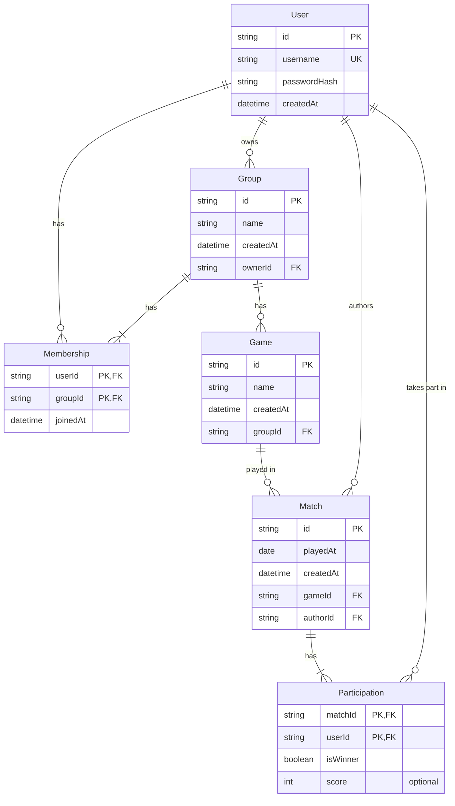

# Data model

## On delete behavior

| Foreign key                | Behavior | Reason                                      |
| -------------------------- | -------- | ------------------------------------------- |
| `Membership.groupId`       | Cascade  | deleting a group removes its memberships    |
| `Game.groupId`             | Cascade  | deleting a group removes its games          |
| `Match.gameId`             | Restrict | a game with matches cannot be deleted       |
| `Participation.matchId`    | Cascade  | deleting a match removes its participations |
| All foreign keys to `User` | Restrict | account deletion is out of V1 scope         |

## Rules enforced in code

- Participants of a match must be members of the game's group.
- A match has at least 2 participants and at least 1 winner.
- A member with participations cannot be removed from a group.
- Game names are unique within a group, case-insensitive.
- Deleting a group runs in a transaction: its matches are deleted first, then the group (games and memberships cascade).

## Design decisions

- **Stats are computed, never stored**: a single source of truth (matches and participations) avoids inconsistencies.
- **`Match` has no `groupId`**: the group is derived from the game, to avoid two paths that could contradict each other.
- **Join tables use composite primary keys**: the database itself prevents duplicate memberships and participations.
